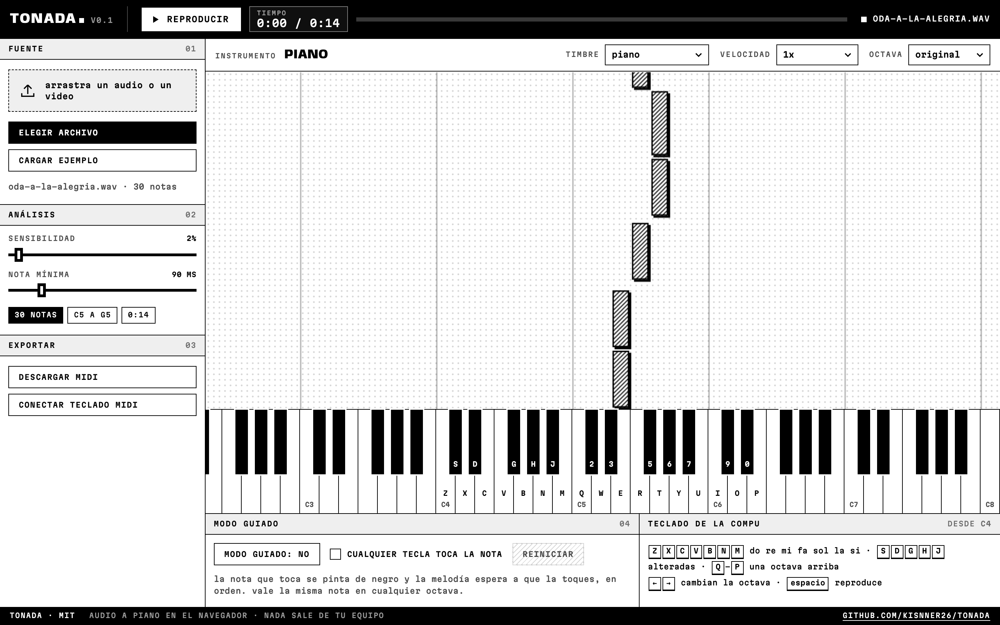
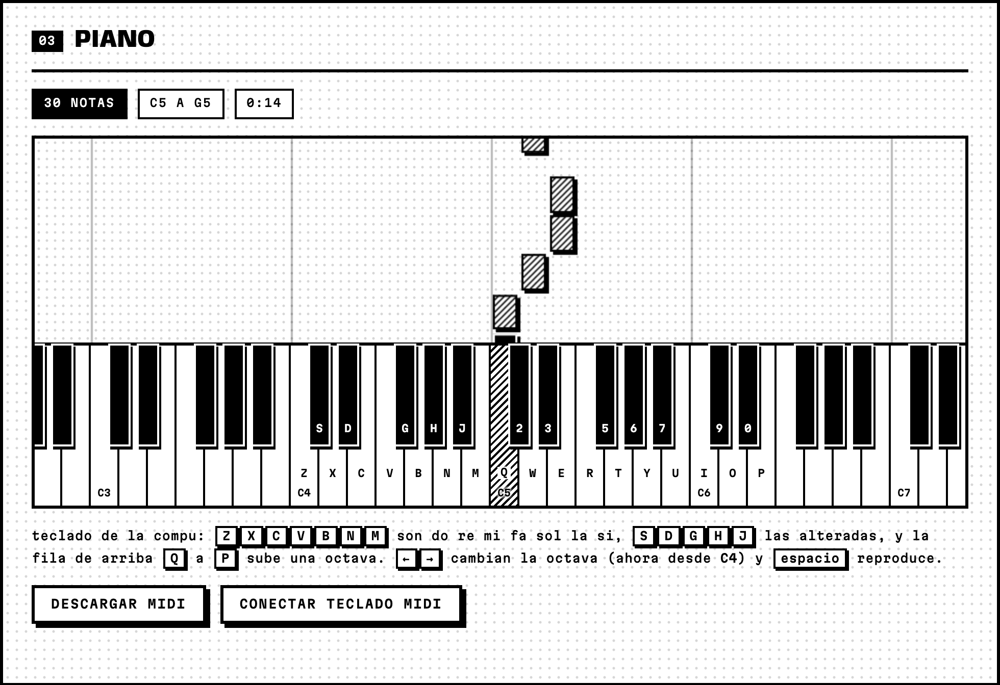
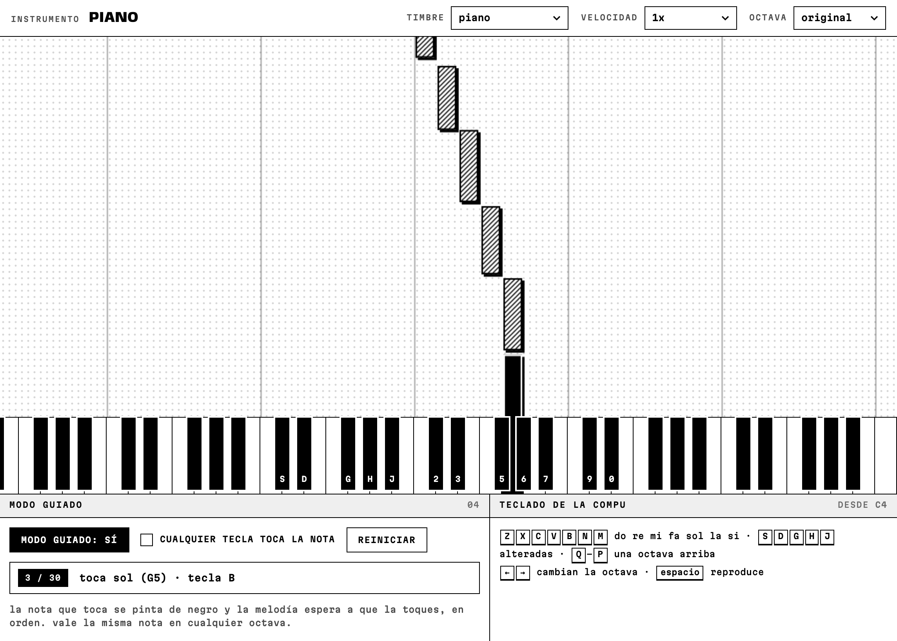
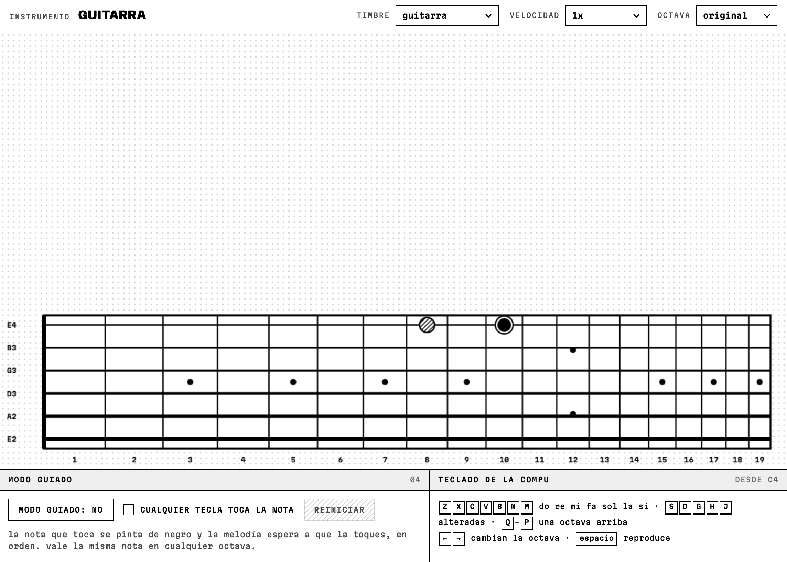
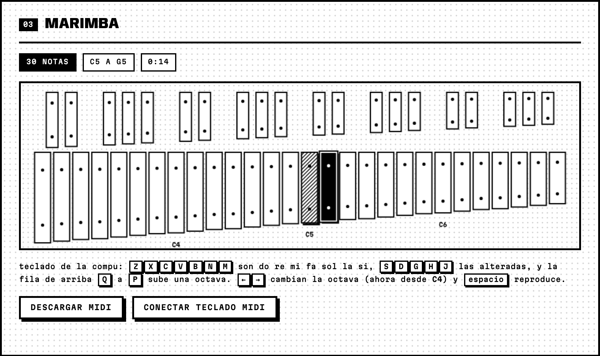
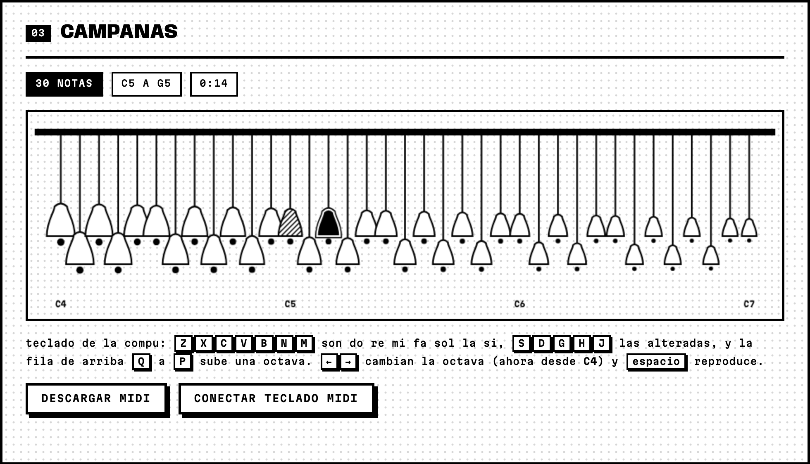
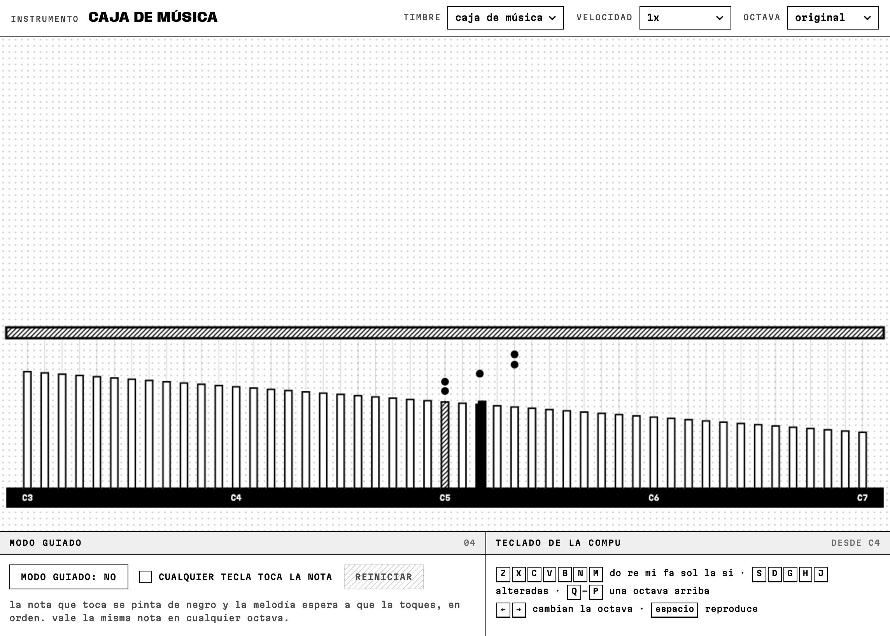
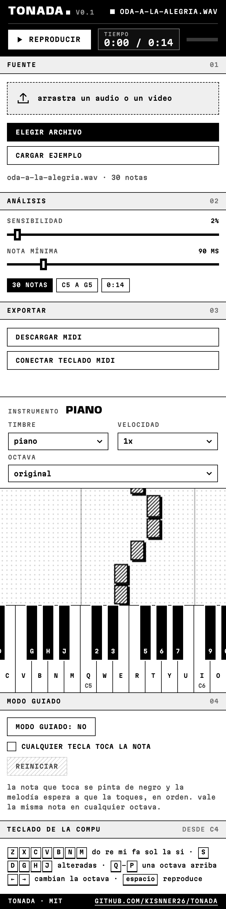

# tonada

audio o video a piano, en el navegador. sueltas un archivo, tonada saca la melodía como notas y las toca en un teclado con la estética risografía de [lumora](https://github.com/kisnner26/lumora), en una sola tinta: negro sobre papel blanco, trama de puntos y sombras duras.

**[probar en vivo](https://kisnner26.github.io/tonada/#ejemplo)**



## qué hace

- lee cualquier audio o video que el navegador sepa decodificar (mp3, wav, m4a, mp4)
- busca el tono dominante cada 23 ms con una fft, lo redondea a nota midi y junta los cuadros iguales en notas con inicio y duración
- suena con diez timbres y siete de ellos cambian la pantalla a su propio instrumento: mástil de guitarra, mástil de violín, marimba, campanas, caja de música, pads y flauta de pan. piano, órgano y sintetizador usan el teclado
- sensibilidad y nota mínima se pueden mover y la transcripción se rehace al instante
- se puede bajar una o dos octavas, tocar más lento y descargar la melodía como `.mid`
- se toca con el teclado de la compu (`Z X C V B N M` son do re mi fa sol la si, la fila de arriba sube una octava), con el ratón arrastrando para hacer glissandos, o con un teclado midi por web midi
- modo guiado: la nota que toca se pinta de negro y la melodía espera a que la toques, en orden. vale la misma nota en cualquier octava, avisa qué tecla pulsar y cuenta aciertos y fallos. con "cualquier tecla toca la nota" solo marcas el ritmo
- nada se sube a ningún servidor, todo corre en tu equipo



## modo guiado



## un instrumento por timbre

| guitarra | marimba |
| --- | --- |
|  |  |
| **campanas** | **caja de música** |
|  |  |

también hay violín, pads de juguete y flauta de pan en `docs/img/`.

## usarlo

es una página estática sin build.

```bash
npm start
```

abre `http://localhost:8080`. por los módulos de javascript no funciona abriendo el `index.html` con doble clic.

en `examples/` hay un audio para probar. el botón "probar con el ejemplo" lo carga.

## pruebas

```bash
npm test
```

generan tonos sintéticos y comprueban que la transcripción devuelva las notas, los tiempos y las repeticiones correctas, que el midi tenga la estructura esperada y que cada timbre arme un grafo de audio válido (rampas, tiempos y conexiones) sobre un contexto falso, que cada vista de instrumento dibuje sin coordenadas rotas y mapee bien las notas a trastes, y que el modo guiado, el teclado de la compu y los mensajes midi se comporten. las capturas de arriba salen de `node tools/captura.mjs`.

## límites

- solo saca una nota a la vez, la más fuerte. acordes, batería y voces mezcladas dan notas inestables
- funciona mejor con melodías de un solo instrumento y poco ruido
- el rango de búsqueda es de 150 a 4000 hz
- analiza como máximo los primeros 5 minutos
- no detecta la dinámica ni el ritmo fino, todas las notas suenan con la misma fuerza
- en el modo guiado la nota esperada vale en cualquier octava, no exige la altura exacta
- la entrada midi necesita un navegador con web midi (chrome, edge)



## estructura

```
js/fft.js        transformada rápida de fourier
js/pitch.js      de muestras a notas
js/synth.js      los diez timbres, con web audio
js/midi.js       escritor de archivos midi
js/keyboard.js   teclas, letras y tecla objetivo
js/roll.js       notas que caen
js/views/        un instrumento por vista: mástiles, marimba, campanas, caja, pads, flauta de pan
js/typing.js     teclado de la compu como piano
js/guide.js      modo guiado
js/midiin.js     teclado midi
js/player.js     agenda y reproduce
js/app.js        une todo
css/             riso.css (tinta y trama) y piano.css
```

## licencia

mit
